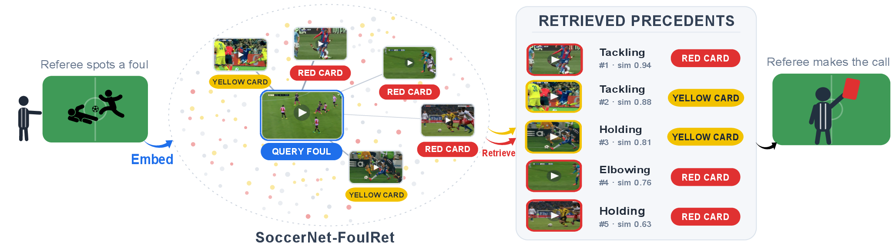

# SoccerNet-FoulRet

Code and evaluation for **SoccerNet-FoulRet**, a benchmark for *semantic* video-to-video
retrieval of soccer fouls. Given a query foul, retrieve past fouls a referee would judge
equivalently, regardless of camera angle, teams, or appearance. Accompanies the paper
*SoccerNet-FoulRet: Retrieving Semantically Similar Soccer Fouls*. 

[](figures/SoccerNet-FoulRet_Teaser.pdf)

A memory bank for referees. We aim to AUGMENT referees, NOT REPLACE them. Automated classifiers and generative explainers emit a verdict directly, but can do so overconfidently and even hallucinate. Instead, our system takes a new foul (left) and retrieves semantically similar precedents together with the decisions that past referees reached on them (right). The referee reasons from these precedents and keeps the final call.


Use this repository to index SoccerNet-MVFoul clips, retrieve similar fouls with
visual or text-mediated models, and evaluate any set of rankings on FoulRet.

## Layout

```
data/foulret/        FoulRet benchmark judgments
Demo/                local Flask interface for video queries
evaluation/          precedent, category, and ablation evaluation
retrieval/           retrieval methods, indexes, and rankings
requirements/        environment-specific dependencies
scripts/             optional setup and SLURM helpers
prepare_dataset.py   create the 16-frame MVFoul dataset
train_qwen3vl.py     fine-tune Qwen3-VL-Embedding-2B
```

## Quick Start

### Recommended demo setup

This is the shortest path to a working installation. It uses
Qwen3-VL-Embedding-2B. You need
[Miniconda or Anaconda](https://docs.conda.io/projects/conda/en/latest/user-guide/install/),
the SoccerNet-MVFoul Train split, and preferably an NVIDIA GPU. A cluster is
not required. Run every command from the repository root.

**1. Clone and install**

```bash
git clone https://github.com/SoccerNet/sn-foulret.git
cd sn-foulret

conda create -n foulret-qwen python=3.11 pip -y
conda activate foulret-qwen

# Prevent packages from other Python installations leaking into this environment.
unset PYTHONPATH
export PYTHONNOUSERSITE=1
python -m pip install --upgrade pip setuptools wheel
python -m pip install -r requirements/qwen.txt -r requirements/demo.txt
```

**2. Add and prepare the data**

Download [SoccerNet-MVFoul](https://github.com/SoccerNet/sn-mvfoul) and place
its Train split at:

```text
data/mvfouls/Train/
  annotations.json
  action_*/clip_*.mp4
```

Then extract the 16-frame windows used by the model:

```bash
python prepare_dataset.py Train
```

**3. Build the complete Train index**

The first run downloads the Qwen3-VL model weights. Building the index is
GPU-intensive.

```bash
python -m retrieval.build_full_index \
  --model qwen3vl-2b \
  --data_dir data/mvfouls_window \
  --index_dir retrieval/indexes/qwen3vl-2b \
  --nframes 16 \
  --clip_mode multi_clip
```

**4. Start the demo**

```bash
bash Demo/run_flask_app.sh
```

Open the URL printed by the launcher. With the default settings, it is
[http://localhost:5000](http://localhost:5000). The demo searches the complete
Train gallery.

## Optional workflows and model backends

Skip this section if you are following the quick start. Create only the
environment required for the workflow you intend to run:

| Use | Environment | Additional source code |
|---|---|---|
| Evaluate included rankings | `foulret-eval` | none |
| Run VARS+XVARS or Qwen3-VL | `foulret-qwen` | none |
| Run VLM2Vec-V2 or LamRA | `foulret-vlm2vec` | `Clones/VLM2Vec` |
| Run InternVideo2 | `foulret-internvideo2` | `Clones/InternVideo` |

Keep these as separate environments: the backends require incompatible pinned
versions of Torch, Transformers, PEFT, and NumPy.

### Evaluation only

```bash
conda create -n foulret-eval python=3.11 pip -y
conda activate foulret-eval
unset PYTHONPATH
export PYTHONNOUSERSITE=1
python -m pip install --upgrade pip
python -m pip install -r requirements/evaluation.txt
```

### Qwen3-VL without the demo

```bash
conda create -n foulret-qwen python=3.11 pip -y
conda activate foulret-qwen
unset PYTHONPATH
export PYTHONNOUSERSITE=1
python -m pip install --upgrade pip setuptools wheel
python -m pip install -r requirements/qwen.txt
```

### VLM2Vec-V2 or LamRA

```bash
git submodule update --init Clones/VLM2Vec
conda create -n foulret-vlm2vec python=3.11 pip -y
conda activate foulret-vlm2vec
unset PYTHONPATH
export PYTHONNOUSERSITE=1
python -m pip install --upgrade pip setuptools wheel
python -m pip install -r requirements/vlm2vec.txt -r requirements/demo.txt
```

### InternVideo2

```bash
git submodule update --init Clones/InternVideo
conda create -n foulret-internvideo2 python=3.11 pip -y
conda activate foulret-internvideo2
unset PYTHONPATH
export PYTHONNOUSERSITE=1
python -m pip install --upgrade pip setuptools wheel
python -m pip install torch==2.4.1 torchvision==0.19.1 \
  --index-url https://download.pytorch.org/whl/cu121
python -m pip install -r requirements/internvideo2.txt -r requirements/demo.txt
```

This adapter uses InternVideo2's standard PyTorch attention path, so
FlashAttention is not required. InternVideo2-1B is gated: accept the conditions on the
[model page](https://huggingface.co/OpenGVLab/InternVideo2-Stage2_1B-224p-f4),
then run `hf auth login` from the InternVideo environment. Model weights are
downloaded from Hugging Face on first use.

Equivalent optional setup scripts are available under `scripts/setup/`.

## Data

Obtain [SoccerNet-MVFoul](https://github.com/SoccerNet/sn-mvfoul) and place it in
`data/mvfouls/`. Each `{Train,Valid,Test}` split must contain its action folders
and `annotations.json`. Train is the gallery; Valid and Test are the queries.

Before building an index or running retrieval, extract the 16-frame temporal
windows used by the models:

```bash
conda activate foulret-qwen     # or the required model-specific environment
python prepare_dataset.py       # -> data/mvfouls_window/
```

To evaluate the existing rankings already in the codebase without processing videos, copy only the annotations:

```bash
conda activate foulret-eval
python prepare_dataset.py --annotations-only
```

All subsequent commands use `data/mvfouls_window/`.

## Run retrieval

The following example retrieves Test queries with Qwen3-VL-Embedding-2B. After
installing its environment and preparing the dataset:

```bash
conda activate foulret-qwen
MODEL=qwen3vl-2b

python -m retrieval.build_full_index \
  --model "$MODEL" \
  --data_dir data/mvfouls_window \
  --nframes 16 \
  --clip_mode multi_clip \
  --index_dir "retrieval/indexes/$MODEL"

python -m retrieval.retrieve \
  --model "$MODEL" \
  --index_base "retrieval/indexes/$MODEL" \
  --data_dir data/mvfouls_window \
  --nframes 16 \
  --clip_mode multi_clip \
  --instruction "Retrieve videos similar to the query video." \
  --splits Test \
  --views full \
  --top_k 20 \
  --out_dir "retrieval/rankings/$MODEL"
```

The retrieved Train action IDs are written to
`retrieval/rankings/qwen3vl-2b/test_full.json`.

Other model keys are `qwen3vl-8b`, `vlm2vec-v2`, `lamra`,
`internvideo2-1b`, and `internvideo2-6b`. Activate the corresponding environment
from the setup table before changing `MODEL`.

For category-relevance retrieval, derive the label-complete indexes and run all
three gallery views:

```bash
python -m retrieval.derive_label_complete_indexes \
  --index_dir "retrieval/indexes/$MODEL" \
  --data_dir data/mvfouls_window

python -m retrieval.retrieve \
  --model "$MODEL" \
  --index_base "retrieval/indexes/$MODEL" \
  --data_dir data/mvfouls_window \
  --nframes 16 \
  --clip_mode multi_clip \
  --instruction "Retrieve videos similar to the query video." \
  --out_dir "retrieval/rankings/$MODEL"
```

These commands overwrite that model's included ranking files. Use `git diff` if
you want to compare the new rankings with the repository versions.

### VARS+XVARS retrieval

```bash
conda activate foulret-qwen
python -m retrieval.vars_xvars.retrieve --split Test
python -m retrieval.vars_xvars.retrieve --split Valid
```

Results are written to `retrieval/vars_xvars/rankings/`.

## Demo options and troubleshooting

The Quick Start builds the complete Qwen3-VL Train index. The launcher never
builds an index automatically; if an index file is missing, it exits with a
warning and prints the build command that must be completed first.

### Other models and settings

Configure another model or port with environment variables:

```bash
MODEL=vlm2vec-v2 PORT=8080 bash Demo/run_flask_app.sh

MODEL=qwen3vl-2b-finetuned \
LORA_PATH=finetuning_outputs/qwen3vl-2b-labelsup/best_model \
bash Demo/run_flask_app.sh
```

Run the launcher from the environment for the selected model. It uses the
active environment's `python`; override it with `PYTHON_BIN` if needed. You can
also override `DATA_DIR`, `INDEX_DIR`, `TOP_K`, `HOST`, or `PORT`. The default
`HOST=127.0.0.1` keeps the development server local; do not expose it directly
to the internet.

All registered models support uploaded MP4 video-to-video queries.

### Troubleshooting

| Message or symptom | Resolution |
|---|---|
| `Python was not found` | Install Conda and activate the required environment from Optional workflows and model backends. |
| `Flask is not installed` | Activate that environment and run `python -m pip install -r requirements/demo.txt`. |
| Model download fills a small home quota | Set `HF_HOME` to a larger location before running the command, for example `export HF_HOME=/path/with/space/huggingface`. |
| `Prepared Train data not found` | Check the dataset layout, then run `python prepare_dataset.py`. |
| `The Train index required by the demo is missing` | Run the printed `retrieval.build_full_index` command, then restart the launcher. |
| Model download is unauthorized | For a gated model, accept its access conditions and authenticate with `hf auth login`. |

## Evaluate rankings

### Your own method

Place your rankings in one directory:

```text
outputs/my_model/
  test_full.json
  valid_full.json
  test_action_offence.json
  valid_action_offence.json
  test_action_offence_severity.json
  valid_action_offence_severity.json
```

Each file maps a query action to an ordered list of Train action IDs:

```json
{
  "action_0": ["89", "action_403", "815"]
}
```

Activate the evaluation environment and prepare the annotations first:

```bash
conda activate foulret-eval
python prepare_dataset.py --annotations-only

python -m evaluation.precedent \
  --rankings-dir outputs/my_model \
  --method-name "My Model"

python -m evaluation.category \
  --rankings-dir outputs/my_model \
  --method-name "My Model"
```

Precedent relevance uses the `full` files. Category relevance uses the
`action_offence` and `action_offence_severity` files.

### Included rankings

The repository includes rankings for all methods in the paper. To evaluate
them without loading the models:

```bash
conda activate foulret-eval
python prepare_dataset.py --annotations-only
python -m evaluation.precedent            # Table 3
python -m evaluation.category             # Table 4
python -m evaluation.instruction_ablation # Table 5
```

## Additional experiments

### Fine-tune Qwen3-VL-Embedding-2B

Fine-tune Qwen3-VL-Embedding-2B with the paper configuration, then build its
indexes and rankings:

```bash
conda activate foulret-qwen

MODEL=qwen3vl-2b-finetuned
RUN_DIR=finetuning_outputs/qwen3vl-2b-labelsup
ADAPTER="$RUN_DIR/best_model"
INDEX_BASE="retrieval/indexes/$MODEL"
RANKINGS="retrieval/rankings/$MODEL"

python train_qwen3vl.py \
  --model_name Qwen/Qwen3-VL-Embedding-2B \
  --data_dir data/mvfouls_window \
  --output_dir "$RUN_DIR" \
  --label_fields action offence severity \
  --clip_mode multi_clip \
  --dev_fraction 0.1 --seed 42 \
  --epochs 10 --patience 3 \
  --batch_size 12 --samples_per_label 2 --gradient_accumulation_steps 8 \
  --lr 1e-5 --weight_decay 0.05 --temperature 0.05 \
  --warmup_ratio 0.1 --scheduler cosine \
  --tier_weights 1 1 1 \
  --lora_rank 16 --lora_alpha 16 --lora_dropout 0.10 \
  --nframes 16 --attn_implementation sdpa \
  --gradient_checkpointing

python -m retrieval.build_full_index \
  --model "$MODEL" --lora_path "$ADAPTER" \
  --data_dir data/mvfouls_window \
  --nframes 16 --clip_mode multi_clip \
  --index_dir "$INDEX_BASE" --force_rebuild

python -m retrieval.derive_label_complete_indexes \
  --index_dir "$INDEX_BASE" \
  --data_dir data/mvfouls_window

python -m retrieval.retrieve \
  --model "$MODEL" --lora_path "$ADAPTER" \
  --index_base "$INDEX_BASE" \
  --data_dir data/mvfouls_window \
  --nframes 16 --clip_mode multi_clip \
  --instruction "Retrieve videos similar to the query video." \
  --out_dir "$RANKINGS"

conda activate foulret-eval
python -m evaluation.precedent \
  --rankings-dir "$RANKINGS" \
  --method-name "Fine-tuned Qwen3-VL-Embedding-2B"
python -m evaluation.category \
  --rankings-dir "$RANKINGS" \
  --method-name "Fine-tuned Qwen3-VL-Embedding-2B"
```

### Instruction ablation

After building a model's full index, run the three retrieval instructions below.
Repeat them for `qwen3vl-2b`, `qwen3vl-8b`, `vlm2vec-v2`, and `lamra`.

```bash
MODEL=qwen3vl-2b
INDEX="retrieval/indexes/$MODEL"
OUTPUT="retrieval/rankings/instruction_ablation/$MODEL"

python -m retrieval.retrieve \
  --model "$MODEL" --index_base "$INDEX" \
  --data_dir data/mvfouls_window --nframes 16 --clip_mode multi_clip \
  --instruction "Retrieve videos similar to the query video." \
  --views full --top_k 20 --no_query_cache --plain_filenames \
  --out_dir "$OUTPUT/generic"

python -m retrieval.retrieve \
  --model "$MODEL" --index_base "$INDEX" \
  --data_dir data/mvfouls_window --nframes 16 --clip_mode multi_clip \
  --instruction "Retrieve soccer foul videos similar to the query." \
  --views full --top_k 20 --no_query_cache --plain_filenames \
  --out_dir "$OUTPUT/domain"

python -m retrieval.retrieve \
  --model "$MODEL" --index_base "$INDEX" \
  --data_dir data/mvfouls_window --nframes 16 --clip_mode multi_clip \
  --instruction "Retrieve soccer foul videos of the same action type, offence, and severity as the query." \
  --views full --top_k 20 --no_query_cache --plain_filenames \
  --out_dir "$OUTPUT/detailed"
```

Evaluate the resulting rankings with:

```bash
conda activate foulret-eval
python -m evaluation.instruction_ablation
```

## Optional SLURM launchers

SLURM is not required. Optional launchers are available under `scripts/slurm/`:

```bash
# Build both index stages, then launch dependent retrieval jobs
BUILD_JOB=$(sbatch --parsable scripts/slurm/run_build_indexes.sbatch qwen3vl-2b)
sbatch --dependency="afterok:$BUILD_JOB" scripts/slurm/run_retrieve.sbatch qwen3vl-2b
sbatch --dependency="afterok:$BUILD_JOB" scripts/slurm/run_instruction_ablation.sbatch qwen3vl-2b

# VARS+XVARS and task-specific fine-tuning
sbatch scripts/slurm/run_vars_xvars.sbatch
sbatch scripts/slurm/run_finetune_qwen3vl.sbatch
```

Adjust the scheduler directives for your cluster.

## Citation

If you use this benchmark, please cite the SoccerNet-FoulRet paper (BibTeX to be added on
publication).
